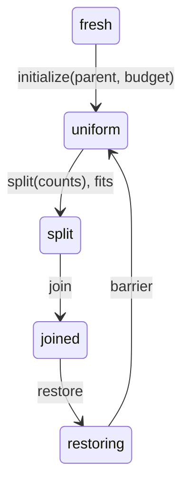

# State-machine experiment

Status: **executable design experiment**, 2026-10-02.

The three examples support a smaller starting point than reflecting the entire typing relation: declare a
protocol as an inductive transition proposition, give commands checked histories, and prove invariants by
induction over those histories. Backlinks follow from the transition introductions. Both explicit certificates
and inferred certificates work in today's Raccoon.

This is evidence for developing a machine-oriented surface with proof-producing elaboration. It does not by itself
establish that a native transition judgement is unnecessary. The subsequent
[compositional experiment](../compositional-machines/README.md) tests opaque callbacks, disjoint resource slices,
loop invariants, changing runtime payloads, and certified structured lowering. Arbitrary GPU parallelism and
dynamic ownership remain open tests of that choice.

## What actually ran

There are no production checker changes, new axioms or evaluation changes. The experiment uses the existing
GPU prelude, `encoding.Registers` budget predicates, and `encoding.Core.setMaxRegs`.

Run from the repository root:

```sh
python3 experiments/state-machines/run.py
```

Set `RACCOON` to a CLI command, or prepare the JVM classpath with `sbt graalvmNativeImageClasspath`. To inspect
the generated certificates, run with `--emit /tmp/raccoon-protocol-fixtures`.

The runner checks every source module, the proof and execution examples, 25 traces in two modes, and the
additional boundary checks. A rejection must have the expected diagnostic kind; malformed syntax, imported
module failures and unrelated fixture-definition failures do not count as successful rejections.

- **Explicit:** the renderer supplies intermediate states and transition introductions. The kernel checks the
  resulting `Run` proof, including every guard and endpoint. The renderer is untrusted.
- **Inferred:** only the initial state, events and required final state are used. `Protocol.infer` selects
  transitions and returns a checked history. Intermediate-state annotations in the fixture are ignored.

The inferred path is an executable reference algorithm for a possible native transition judgement, implemented
as ordinary Raccoon. It is **not** an implementation of that judgement in the checker, nor a general elaborator
for Raccoon expressions. Both paths use the same authoritative `Step` proposition. A selector can fail to find a
legal edge, but cannot produce an illegal one without its own definition failing to check. We have not proved
selector completeness; agreement is tested on the listed traces.

Result: **69/69 checks passed: 23 admissions and 46 expected rejections.** One admission is an intentional
counterexample to an incomplete scope model, described below. `sbt -batch validate` also passed all **928** tests.

## The proof interface

[Protocol.rac](Protocol.rac) defines:

```text
Step(before, event, after) : Prop
Run(step, before, events, after) : Prop
Command(step, before, after) = events + Run proof
```

`Step` is library-defined; the other two are generic. A `Command` is an immutable description of a computation.
Its proof can be copied without granting a second right to execute it. State snapshots and event lists are
unrestricted data; live authority is separate.

The checked generic proofs are:

- `Protocol.append`: a run from A to B followed by a run from B to C gives a run from A to C.
- `Protocol.preserves`: if every edge preserves an invariant, a run preserves it.
- `Frame.lift`: a run over one state can be lifted to a pair of that state and an unchanged unrelated state.
- `Frame.unchanged`: every lifted edge leaves the framed state equal to its initial snapshot.

[Examples.rac](Examples.rac) instantiates these proofs, composes commands, proves a register budget fact, frames
an unrelated state, and executes a reusable register command twice with successive linear cursors. This requires
neither quotation nor reflection of the typing relation.

The cursor executor advances abstract authority only; it does not execute GPU instructions. The CUDA fragment
is generated and checked separately by the lowering example.

These are facts about indexed histories. `Run` from an arbitrary starting state does not establish that a real
machine reached that starting state. The execution interface supplies that connection by issuing its initial
cursor and requiring each command's input state to match the cursor it consumes. A copied history is also not a
timeless assertion about the current machine state.

## Registers: synchronize the restoration, then reuse the pool

[RegisterProtocol.rac](RegisterProtocol.rac) models:



`uniform` includes synchronization. Equality of physical register counts alone does not establish it.
`initialize` checks the claimed parent identifier and the budget computed from that parent's threads and
residency. `split` uses the existing `Registers.fits` predicate. The example configuration is 512 threads, one
resident CTA, budget 128, with counts `(192, 192, 72, 56)`.

The backward theorem has this checked shape:

```text
Step(cfg, s, event, uniform) -> UniformPredecessor(s)
UniformPredecessor = fresh | restoring(counts)
```

`preservesBudget` proves the invariant for one edge; `commandSafe` applies the generic preservation theorem to a
command. Split, joined and restoring states all retain the original `fits` obligation.

Both interfaces admit initialization, a live split, a complete round trip and a repeated round trip. Both reject
wrong parent, wrong budget, wrong residency, invalid counts, excess budget, missing join, missing final barrier,
and a second split before that barrier.

This gives a useful reformulation of [REGISTERS.md §9](../../gpu/encoding/REGISTERS.md): the public interface
should advance the kernel's own register machine, rather than expose an independently callable pool factory.
[Authority.rac](Authority.rac) sketches that boundary with a scoped, sealed, linear cursor. Its builder issues only
`fresh`; its executor consumes the cursor at the command's input state. Finishing requires `uniform`. Cross-parent
execution, cursor duplication and constructor forgery are rejected.

The prototype avoids passing `Core.Key` into a module that Core imports. It does **not** fix the production import
cycle or prove the production `Registers.pool` factory is authorized. Parent identifiers here are ordinary
natural numbers, not a solution to fresh identity or instance generativity. In production, the builder must own
the machine instance and bind its configuration to the actual emitted kernel metadata.

## Read leases: repeated reads, close, synchronize, write

[ReadProtocol.rac](ReadProtocol.rac) models:

```text
ready -> borrowing -> reading -> writable -> retired
          read*        barrier     write*
```

Opening, reading and closing must identify the same loan. Reads can repeat while borrowing. Closing ends those
reads; a barrier restores write authority. The checked backlinks show that `reading` can only be entered from
`borrowing`, and `retired` only from `writable`.

Both interfaces accept repeated reads followed by close, barrier, write and retirement. Both reject a different
loan, read after close, double close, write while borrowed, write before the barrier, and reopening after retirement.

This is a deliberately small borrow/write protocol. Its `writable` state abstracts the return of storage authority;
it does not reproduce every `Core.TileState.afterSync` case or prove synchronization sufficient for arbitrary GPU
memory operations. Loan numbers model identity comparisons, not fresh allocation.

The scope test is decisive about what this graph alone provides.
[scope_graph_counterexample.rac](checks/scope_graph_counterexample.rac) contains a legal open/close history and
returns a closure over an **unscoped** handle. Raccoon accepts it. Its read function lacks any lifetime or current
state requirement, so the history does not restrict that function's later use. This is a counterexample to that
incomplete API, not an escape from Raccoon's existing scope rules.

[Scoped.rac](Scoped.rac) puts the lifetime on the copyable handle. Repeated reads work, while
[escaping_read_closure.rac](checks/escaping_read_closure.rac) fails because its closure carries that lifetime and
cannot satisfy the outer result type.

A native machine feature could subsume scope checks if it also tracks captured dependencies, requires an open
instance at use sites, and accounts for latent closure effects or non-escape. Merely adding open/closed states
does not do those jobs. The experiment retains the existing scope mechanism for them.

## Actors: the leader cannot complete the peer's work

[ActorProtocol.rac](ActorProtocol.rac) models a leader-only region with two outstanding completion obligations:

```text
both pending -> inside, leader pending -> inside, leader done
             -> outside, peer pending -> done
```

There is also a collective `finishBoth` transition directly from `bothPending` to `done`. Inside the leader region,
the checked `peerFrame` theorem proves that the peer remains pending, including when the leader exits. Both
interfaces reject peer completion inside the region, collective completion inside it, exiting before leader
completion, peer completion before entering, and claiming everyone is done after only leader work.

This models the participation obligation relevant to `onLeader`. It is not a proof about the existing
`Core.onLeader` implementation or a general model of arbitrary actor sets. The five phases make control context
explicit in the protocol. A language feature should instead expose actor views and frame the obligations of
absent actors, so libraries need not enumerate every product of control phase and resource state.

## A valid history still needs a correct implementation

[Lowering.rac](Lowering.rac) adds a separate, concrete A3b restoration contract. The specification demands four
warpgroup guards, the correct `.inc` or `.dec` to 128, and a final CTA barrier. The implementation uses the existing
`Core.setMaxRegs`; the kernel checks equality of the final CUDA block to that specification, including its execution order.

The witness carries both a valid `split -> uniform` history with the required join/restore/barrier events and the
emission correspondence proof. Keeping the abstract history valid while deleting the emitted barrier or changing
the first decrement to an increment fails the correspondence proof. Reversing the emission order also fails.

[Smoke.rac](Smoke.rac) checks the repeated execution and scoped read results and renders the certified fragment.
This is a local AST contract for concrete counts. It is not a general CUDA semantics, a verification of
`Core.regsBack`, or a proof that abstract protocol labels correspond to all operations in the current GPU library.
That correspondence remains a separate obligation under either language design.

## What the ideal interface should expose

The desired surface can hide explicit cursors and intermediate states while exposing machine instances,
transitions and their proof obligations. For example, this **illustrative, unimplemented syntax** describes the
register example:

```text
with kernel.registers as regs:
  regs.split(192, 192, 72, 56):
    warpgroup 0: ...
    warpgroup 1: ...
    warpgroup 2: ...
    warpgroup 3: ...
  // The construct joins roles, restores counts and synchronizes.
  // The postcondition is regs @ uniform; a second split is permitted.
```

A read construct similarly lends copyable access with a dependency on its open loan instance. A leader construct
narrows the acting participants and retains the other actors' obligations. Proofs name the generated `Step` and
`Run` propositions rather than inspect token constructors or reconstruct the entire typing derivation.

A possible native judgement is:

```text
Γ; Δ, instance @ P; actors ⊢ expression : A ▷ Δ, instance @ Q
```

It must account for instance initialization authority, transition guards, actor participation, resource
conservation, framing, captured loan dependencies, and eventual retirement. P and Q describe stable snapshots;
the judgement grants the right to advance the actual instance. Its evidence can elaborate to the same `Run`
propositions used here. The experiment demonstrates the proof interface; it does not implement this judgement.

| Existing feature | What this experiment supports |
| --- | --- |
| Full typing reflection | Not needed for the tested protocol histories, backlinks or local emission contract. Still relevant to theorems about arbitrary existing client code. |
| Linearity | Still required for execution authority. A native ledger could hide or replace explicit cursors while preserving conservation. |
| Sealing | Used to prevent cursor forgery. Machine-owned initialization could replace individual mint gates; representation abstraction remains a separate reason to seal. |
| Scopes | Still required for captured handles here. A richer machine judgement could integrate equivalent dependency/use constraints. |
| `Fixed` | No conclusion: this experiment does not exercise generated loops, branch payloads or host/runtime value separation. |
| Implicits and quotation | No change required by these examples. Proof-producing elaboration is compatible with eager evaluation. |

The proof bodies are short, but there are two ergonomic costs in the current core. Structural recursion needs
retained event data rather than an erased proof. Also, a direct match for the uniform backlink retained a
`MissingCase` under the current conservative exclusion checker; a total incoming-edge predicate and a complete
match over all constructors checked successfully. The rejected direct form is retained as
[direct_backlink_exclusion.rac](checks/direct_backlink_exclusion.rac) to make that limitation reproducible. These motivate nicer generated proof interfaces, not broader
trusted inference rules by themselves.

The next discriminating language-design test is a higher-order, actor-aware split with two independent machine
instances, captured read handles and a generated loop with an invariant. If one surface elaborates that to small
linear/scoped terms and these history proofs, the present kernel is a plausible foundation. If expressing
participation, capture dependencies or abstract loop states requires a new semantic rule, that is a concrete
reason to add it to the judgement. The three finite traces alone do not decide that question.
